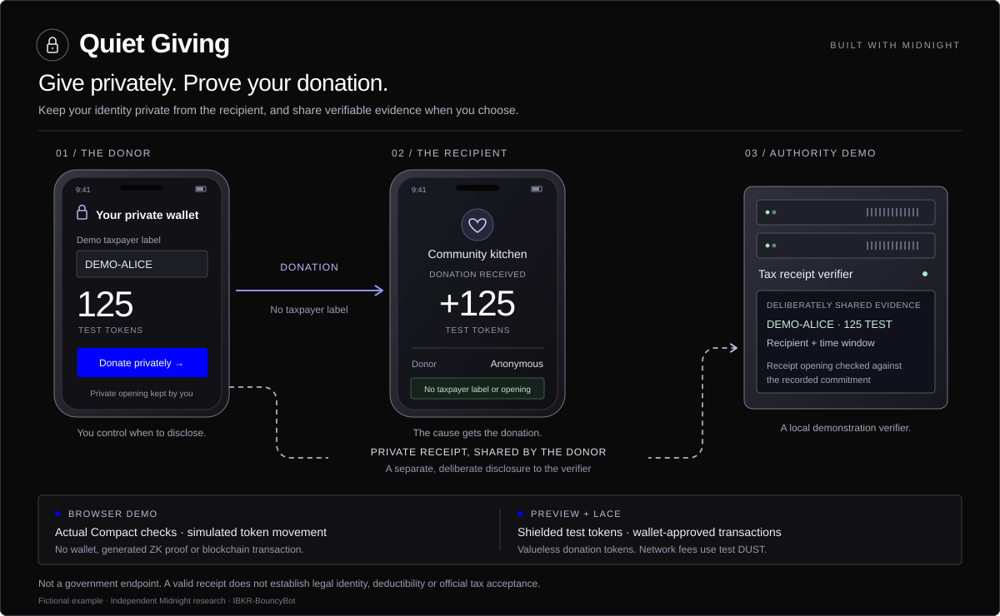
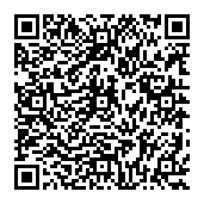

# Quiet Giving

**Give privately. Prove your donation.**

Keep your identity private from the recipient, and share verifiable evidence when you choose.

A graphic Midnight prototype showing a donor phone, a recipient phone and a tax-authority verifier. The recipient receives a donation without receiving the donor's taxpayer identifier. The donor keeps a private receipt and can deliberately disclose it to a separate verifier.

[Open the app](https://ibkr-bouncybot.github.io/Midnight-Quiet-Giving/) · [Browser demo](https://ibkr-bouncybot.github.io/Midnight-Quiet-Giving/browser.html) · [Preview + Lace](https://ibkr-bouncybot.github.io/Midnight-Quiet-Giving/network.html)



## Two ways to explore

| Mode | What it does | What you need |
| --- | --- | --- |
| Browser demo | Executes the generated Compact contract and Midnight WebAssembly locally. Try donations, private disclosures, tamper detection and public exports. Balances are illustrative. | A modern browser; no wallet or tokens. |
| Preview + Lace | Connects the real API-4 wallet, deploys or joins a donation contract, mints valueless test tokens, and requests actual shielded donation transactions. Lace handles proofs and approvals. | Lace on Preview, usable test DUST, internal WASM proving, and the recipient's shielded public keys. |

The browser demo generates no zero-knowledge proof and submits no transaction. The network client reports proving, submission and confirmation separately. GitHub Pages hosts the frontend; it does not run a tax server, prover or blockchain node. See [verification](docs/VERIFICATION.md) for what has actually been tested.

**Verification status:** the browser journey and separate real WASM proof-generation checks pass. A full donation through Lace on Preview remains unverified; the isolated real-extension runs stopped during wallet setup.

## Try the browser demo

1. Choose an illustrative donor and recipient, enter an amount and a fictional taxpayer reference.
2. Send a demonstration donation. The recipient phone shows receipt of the amount without showing that taxpayer reference.
3. Share the private disclosure with the authority demo. Its verifier checks the commitment against the contract record in this browser session.
4. Change a receipt field to see verification fail. Compare a public export with the deliberately private disclosure download.

All three roles run in one browser for illustration. The server graphic is a local demonstration verifier, not a government endpoint. Private receipt downloads reveal sensitive openings to whoever receives them; use fictional identifiers in this prototype.

## How the evidence works

The donation circuit binds a receipt to a specific campaign, deployed contract, recipient, asset, amount, validity window, taxpayer-reference digest and donor secret. A fresh random salt hides the receipt contents. The same transaction funds a fresh contract-owned shielded coin and transfers its entire value to the immutable recipient.

Public ledger state contains a receipt identifier and its commitment, not the taxpayer reference or private opening. For the prototype's authority workflow, the donor explicitly shares a **commitment opening**. This is verifiable private evidence, not a separate zero-knowledge tax presentation. The verifier can check that opening against the indexed contract record without publishing it back to Midnight.

The identifier is self-entered, so this proves no legal identity. A recipient public key is not proof that its owner is a registered charity. Test tokens have no monetary value or tax deduction. Receipt verification does not establish legal eligibility, a fiat valuation, the absence of compensation, or acceptance by a tax authority. Those require a production identity and evidence process. See [privacy and trust](docs/SECURITY.md).

## Development

The project follows BallotLab, Agent AI Wallet and ReviewLab: locally hosted Outfit, Midnight's dark palette and electric-blue controls, ordinary GitHub Pages, and pinned Midnight libraries.

Use Node.js 24, Compact compiler 0.31.1, compact-runtime 0.16.0 and Midnight.js 4.1.1. Windows compilation uses WSL; Linux can use the official `compact` launcher.

```sh
npm ci --ignore-scripts
npm run compile
npm test
npm run build
npm run dev
```

Open the local URL printed by the server. For browser acceptance, install Playwright Chromium and run:

```sh
npx playwright install chromium
npm run test:browser
```

Generated contract bindings and proving keys belong in ignored `contracts/managed/`. CI regenerates them with the official compiler. The build fails if the genuine bindings, proof material or WebAssembly dependencies are missing. The committed lockfile records the installed dependency graph.

## Guides

- [Preview and Lace setup](docs/TESTNET.md)
- [Contract and disclosure design](docs/ARCHITECTURE.md)
- [Privacy, recovery and trust boundaries](docs/SECURITY.md)
- [Verification and independent Lace testing](docs/VERIFICATION.md)
- [GitHub Pages deployment](docs/DEPLOYMENT.md)

## Buy me a coffee

If Quiet Giving is useful to you, you can support IBKR-BouncyBot with an optional **NIGHT or ADA tip on Cardano mainnet**. Both demos remain free. This support address is separate from the app's Preview test wallets and is not part of the tax-receipt demonstration.



```text
addr1q85w2v474ywzx868s69pghygek3vrhxm69e7c6ysuf28qhv8kmj5wd059grxl82f8h5mtyzl87cvqj8ldv2e0las7tnsdej9ax
```

The [website's support section](https://ibkr-bouncybot.github.io/Midnight-Quiet-Giving/#support) also has a copy button.

## License

Project-owned code and graphics use [PolyForm Noncommercial 1.0.0](LICENSE). Commercial use requires separate written permission from IBKR-BouncyBot. Third-party components retain their own licenses; see [NOTICE.md](NOTICE.md).
